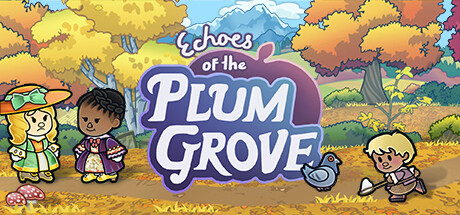

**Echoes of the Plum Grove is a cozy farming simulation with life, death, and generational legacy mechanics where your villagers age, die, and leave children who inherit the village. Features seasonal events and a beautifully melancholic take on the farming sim genre.**

---

## 📖 About

Echoes of the Plum Grove is a cozy farming simulation with life, death, and generational legacy mechanics where your villagers age, die, and leave children who inherit the village. Features seasonal events and a beautifully melancholic take on the farming sim genre.

## ⚠️ Problems Without Trainer

| Problem | Status |
|---------|--------|
| **Villager Death** — Beloved villagers aging and dying creates emotional attachment challenges | ✅ Solved |
| **Winter Scarcity** — Cold season eliminates crop income requiring advance food preservation preparation | ✅ Solved |
| **Relationship Building** — Developing village relationships requires daily social investment over seasons | ✅ Solved |
| **Heir Management** — Choosing the right heir for specific skill inheritance requires planning ahead | ✅ Solved |

## ✅ Solution

The **Echoes of the Plum Grove Trainer** solves all these issues by giving you complete control over the game.

## 🎯 Full Feature List

- Unlimited Resources
- God Mode / Invincibility
- Instant Skill Cooldown
- One-Hit Kill
- Freeze Game Timer
- Unlock All Items & Achievements
- Custom Speed Multiplier
- Save State Anywhere

## 🚀 Quick Start

1. **Disable Windows Defender** temporarily (trainer may trigger false positive)
2. Download the trainer from the button above
3. Launch Echoes of the Plum Grove
4. Run the trainer as Administrator
5. Activate desired cheats with hotkeys

## 💎 Free vs Paid

| Feature | Free | Pro |
|---------|------|-----|
| Basic God Mode | ✅ | ✅ |
| Unlimited Resources | ✅ | ✅ |
| All Advanced Cheats | ❌ | ✅ |
| Auto-Updates | ❌ | ✅ |
| Priority Support | ❌ | ✅ |

## 💻 Requirements

- Windows 10/11 (64-bit)
- Echoes of the Plum Grove (any version)
- .NET Framework 4.8+
- DirectX 11+

## 🍎 macOS

macOS users can use our alternative tool:

## ⚖️ Legal

This trainer is for educational and single-player use only. Use responsibly.

---

